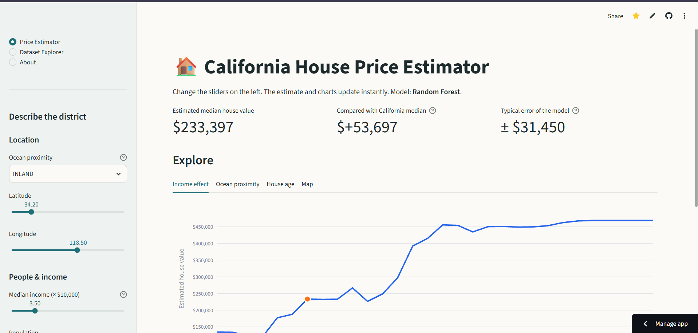

# House Price Prediction System

An educational machine-learning project that compares three regression models on California housing data and serves the best one in an interactive Streamlit app.



## Purpose
Estimate the **median house value of a California district** (in 1990 US dollars) from census features: income, location, housing age, population and ocean proximity.

## Dataset
- **Source:** California Housing dataset (1990 US census), `data/housing.csv`.
- **Size:** 20,640 districts, 9 input features, target `median_house_value`.
- **Units:** prices in US dollars (1990). Each row is a **district**, not a single house, so rooms, bedrooms, population and households are district totals.
- **Missing values:** 207 values of `total_bedrooms`. They are filled with the training-set median inside the pipeline.
- **Price cap:** prices are capped at 500,001. 965 districts (about 4.7%) sit at the cap.

| Column | Meaning |
|---|---|
| `median_house_value` | Target: median house value of the district (USD) |
| `median_income` | Median income of the district (units of $10,000) |
| `housing_median_age` | Median age of the houses in the district (years) |
| `total_rooms`, `total_bedrooms` | Totals for the district |
| `population`, `households` | Residents and households in the district |
| `latitude`, `longitude` | Location of the district |
| `ocean_proximity` | Category: `<1H OCEAN`, `INLAND`, `NEAR OCEAN`, `NEAR BAY`, `ISLAND` |

## Features added (feature engineering)
Three ratio features are created before the train/test split with `add_features` in `src/data_preprocessing.py`. They are computed row by row, so they cause no data leakage.

- `rooms_per_household`
- `bedrooms_per_room`
- `population_per_household`

## Models
| Model | Role |
|---|---|
| Linear Regression | Baseline |
| Decision Tree | Non-linear, depth-limited (`max_depth=8`, `min_samples_leaf=10`) |
| Random Forest | Best model (`n_estimators=200`, `min_samples_leaf=2`) |

All three share one `Pipeline` (imputer, scaler, one-hot encoder, model), so the comparison is fair and there is no data leakage. The split is 80/20 with `random_state=42`.

## Results (test set, 4,128 districts, with ratio features)
| Model | Train R² | CV R² | Test R² | Test MAE | Test RMSE |
|---|---|---|---|---|---|
| Linear Regression | 0.658 | 0.655 | 0.635 | $49,645 | $69,127 |
| Decision Tree | 0.775 | 0.725 | 0.709 | $41,607 | $61,720 |
| Random Forest | 0.961 | 0.812 | 0.813 | $31,758 | $49,447 |

R² is the share of price variation the model explains on unseen data. It is not a percentage accuracy score. MAE and RMSE are in US dollars.

### Effect of the ratio features
| | Original 8 features | With 3 ratio features |
|---|---|---|
| Linear Regression test R² | 0.625 | 0.635 |
| Decision Tree test R² | 0.707 | 0.709 |
| Random Forest test R² | 0.818 | 0.813 |
| Random Forest test MAE | $31,450 | $31,758 |

The ratio features helped Linear Regression and slightly helped the Decision Tree. They made no meaningful difference to Random Forest (a drop of 0.005 R²), which can learn such combinations from the raw columns itself. Random Forest is the best model in both cases.

`median_income` is by far the most important feature (about 49%), followed by being inland (about 14%) and `population_per_household` (about 12%). Longitude and latitude contribute about 6% each.

## The app
Run it with `streamlit run app.py`. A sidebar menu switches between three pages.

| Page | What it does |
|---|---|
| **Price Estimator** | Sliders for the district's features give a live estimate, plus charts: income effect, ocean proximity comparison, house age effect and a map. Shows the model's typical error. |
| **Dataset Explorer** | Upload a CSV (or use the built-in data). It is validated, then shown with a preview, cleaning summary, column types, missing values, summary statistics and four charts. Uploaded files are explored only; predictions always use the saved model. |
| **About** | Dataset source, units, model details and limitations. |

Validation messages cover: wrong file type, empty file, missing target column, missing feature columns, non-numeric target values, duplicates, missing values, and datasets that are too small.

## Project structure
```
House-price-prediction/
├── .streamlit/config.toml     # app theme
├── data/housing.csv
├── models/                    # saved by the notebook
│   ├── best_model.joblib
│   ├── metadata.joblib
│   └── model_comparison.csv
├── src/
│   ├── data_preprocessing.py  # load, clean, add features, split, preprocessing pipeline, upload validation
│   ├── model_training.py      # model definitions, training, saving
│   └── evaluation.py          # metrics and price-cap check
├── tests/                     # 23 automated tests (pytest)
│   ├── conftest.py
│   ├── test_preprocessing.py
│   ├── test_models.py
│   └── test_validation.py
├── screenshots/
├── app.py                     # Streamlit entry point (pages, loading, predicting)
├── ui.py                      # Streamlit layout and charts
├── house_price_analysis.ipynb # full analysis
├── pytest.ini
└── requirements.txt
```

## Notebook outline
1. Imports and configuration
2. Data collection and exploration
3. Data cleaning
4. Train/test split
5. Exploratory data analysis
6. Preprocessing pipeline
7. Model definitions
8. Training
9. Evaluation
10. Effect of the price cap
11. Visual model comparison
12. Feature importance
13. Save the best model
14. Conclusions and limitations

## Setup and run
```bash
python -m venv venv
venv\Scripts\activate          # Windows (use: source venv/bin/activate on macOS/Linux)
pip install -r requirements.txt
```
1. Open `house_price_analysis.ipynb` from the project root and run all cells. This creates the files in `models/`.
2. Start the app:
```bash
streamlit run app.py
```

The saved model must be loaded with the same scikit-learn version that trained it. If loading fails, reinstall the version you trained with (`pip show scikit-learn`) or re-run the notebook.

## Reproduce the results
```bash
pip install -r requirements.txt
pytest                      # 23 tests
# run all cells in house_price_analysis.ipynb (creates models/)
streamlit run app.py
```
The random seed (42) and the 80/20 split are fixed in `src/data_preprocessing.py`, so the numbers repeat.

## Testing
`pytest` runs 23 automated tests on the code in `src/`:
- ratio features: correct values, zero denominators give NaN (not infinity), input is not modified
- cleaning, splitting (no overlap between train and test), missing values and unknown categories in the pipeline
- all three models train and predict from raw rows; metrics table; price-cap check; saving the model files
- upload validation: wrong file type, empty file, missing target or feature columns, invalid target values, duplicates, missing values, too-small datasets

## Limitations
- **Old data:** 1990 census. Do not use it to value real property today.
- **Price cap:** the highest prices are unknown, so expensive districts are underpredicted (by about $76,000 on average for capped districts).
- **District level:** predictions are for a district's median value, not one house.
- **Rare category:** `ISLAND` has 5 rows, so its predictions are unreliable.
- **Overfitting gap:** Random Forest train R² (0.96) is above its test R² (0.81). No hyperparameter tuning was done.
- **Upload page:** uploaded files are validated and explored, but the model is not retrained on them.

**Next steps:** tune with `GridSearchCV`, try Gradient Boosting, optionally retrain on an uploaded file.

> **Disclaimer:** educational project only. Not a property valuation, appraisal or financial advice.
